<!-- Put this file + the /assets folder in a public repo named exactly "kewkatoo". -->

  

  electronics &amp; computer engineering graduate from amrita vishwa vidyapeetham. 
  i build complete ai systems, from data processing and inference to apis, 
  hardware integration and real-world interaction.

  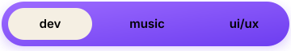

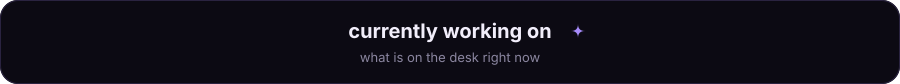

  <a href="https://github.com/kewkatoo?tab=repositories"></a>
  <a href="https://github.com/kewkatoo?tab=repositories"></a>

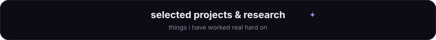

  <a href="https://github.com/kewkatoo?tab=repositories"></a>
  <a href="https://github.com/kewkatoo?tab=repositories"></a>
  <a href="https://github.com/kewkatoo/Music-Tracklist-Recommendation-System"></a>
  <a href="https://github.com/kewkatoo/smart-helmet"></a>

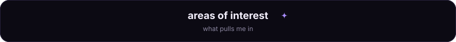

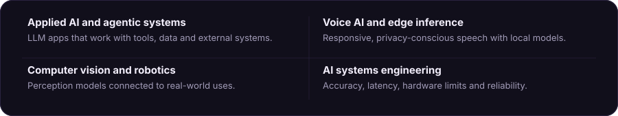

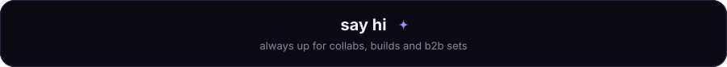

  
  <!-- TODO: replace with your real profile URL -->
  
  <!-- TODO: replace or delete -->
  <a href="https://aditya-achary-mu.vercel.app"><

