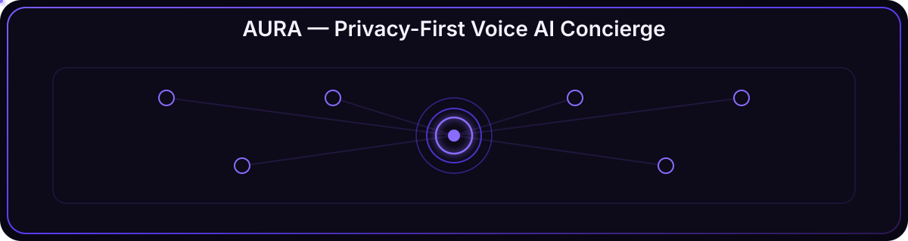
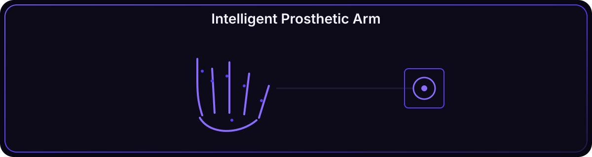
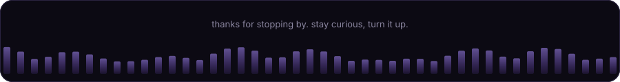

<!-- Public repo named exactly "kewkatoo". Needs: README.md, assets/, scripts/, .github/ -->

  

  

  electronics &amp; computer engineering graduate from amrita vishwa vidyapeetham. 
  i build complete ai systems, from data processing and inference to apis, 
  hardware integration and real-world interaction.

  

  

  

  

  

  

  
  
  

  

