<!-- Public repo named exactly "kewkatoo". Needs: README.md, assets/, scripts/, .github/ -->

  

  
    <a href="https://github.com/kewkatoo?tab=repositories">AURA</a> &nbsp;·&nbsp;
    <a href="https://github.com/kewkatoo?tab=repositories">Prepper</a> &nbsp;·&nbsp;
    <a href="https://github.com/kewkatoo?tab=repositories">Prosthetic Arm</a> &nbsp;·&nbsp;
    <a href="https://github.com/kewkatoo/Music-Tracklist-Recommendation-System">Song Recommendation</a> &nbsp;·&nbsp;
    <a href="https://github.com/kewkatoo/smart-helmet">Smart Helmet</a> &nbsp;·&nbsp;
    <a href="https://github.com/kewkatoo?tab=repositories">Bus Detection</a>
  

  
  
  

